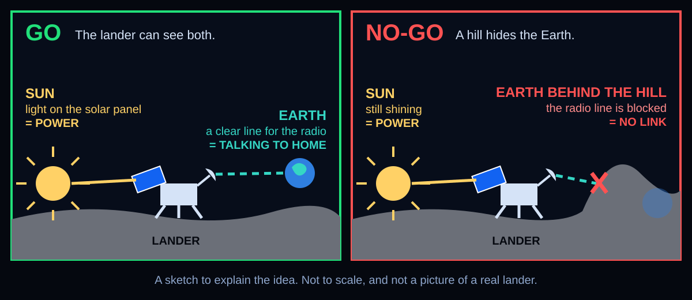
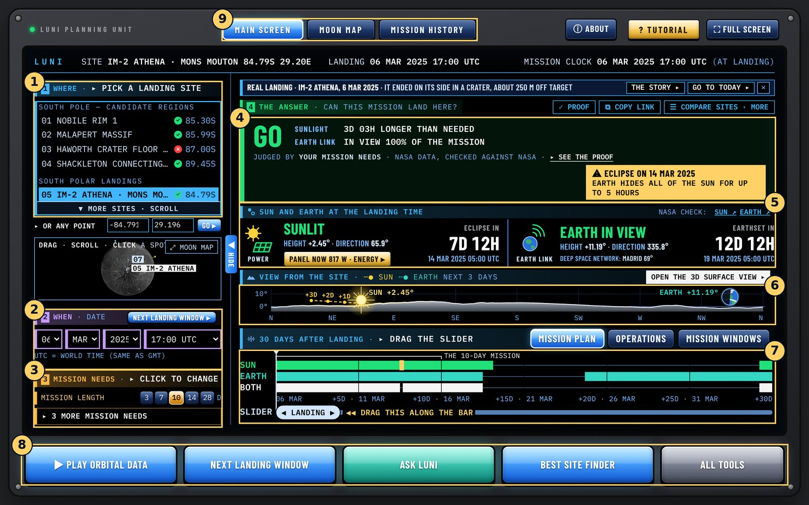

# Plan a Moon landing: a 45-minute lesson with LUNI

**For:** grades 6 to 9 (works for older students and clubs too). **Needs:** one laptop or Chromebook per pair, a web
browser, no accounts and no installs. **Tool:** <https://galileoleosolis.github.io/LUNI/>

LUNI (Lunar Utility for Navigational Intelligence) answers one question with real NASA data: *can this mission land
here, at this time?* Students use it the way a mission planner would: pick a place and a time, read the GO or NO-GO,
find out why, and fix the plan.

## For the teacher: do these first

Everything in this section happens **before students arrive**. It takes about 15 minutes the first time. You do not
need to know anything about the Moon or about the tool: the sample answers are all in the teacher key at the end.

### You do not have to be a science teacher

This lesson is for any teacher. It is not really about the Moon; it is about making a plan, finding out it does not
work, working out why, and trying again. That is worth teaching in every subject.

- **You are allowed not to know.** When a student asks something you cannot answer, say "I don't know, let's find
  out", and look at the screen together. That is the lesson working, not the lesson failing.
- **A NO-GO is not a wrong answer.** It is the tool telling you something. The best moment in this lesson is the red
  NO-GO in Part 4, because it gives the class a problem to solve.
- **Try it wrong on purpose.** Before class, pick a site and a date at random and see what happens. Then press NEXT
  LANDING WINDOW. Five minutes of this and you have done everything the students will do.
- **Let them see you be curious.** Students notice what you do when you are stuck. Trying,
  failing, staying curious and going back for another try is the skill here; the Moon is only where it happens.

### The day before

- [ ] **Try the link on a student device**, not only your own: <https://galileoleosolis.github.io/LUNI/>. If it does
      not load, the school's web filter may be blocking it; ask for `galileoleosolis.github.io` to be allowed.
- [ ] **Check the devices.** Laptops or Chromebooks, with an internet connection and a current browser. Chrome and
      Edge are the two it has been tested on. No accounts, nothing to install. Phones are too small for this lesson.
- [ ] **Press ? TUTORIAL** (top right of the tool) and click through it once yourself. About 5 minutes.
- [ ] **Read the teacher key** at the end of this page. About 3 minutes.
- [ ] **Print the worksheet,** one per pair. It is near the end of this page.

### Just before class

- [ ] **Pair the students,** one device per pair. In each pair one student clicks and the other reads the worksheet
      aloud; they swap for mission two.
- [ ] **Put the tool on the projector** and press **FULL SCREEN** (top right).
- [ ] **Open the two videos in other tabs,** if you plan to show them.
- [ ] **Write the five words to know on the board,** and leave room for the mission-one plan.

### If the technology fails

- **One device will not load it:** move that pair to share with another pair.
- **Nothing loads:** teach "Start here" from the sketch, show the two NASA videos, and do the worked example and
  mission one as a whole class from the printed picture of the screen. Students still fill in the worksheet.
- **A student asks "how do you know this is real?":** press **PROOF** in the tool. Everything on screen is computed
  from NASA data.

### The lesson at a glance

| Part | Minutes | Who does what |
|---|---|---|
| 1. Hook: a real landing that went wrong | 5 | Teacher, on the projector |
| 2. Guided tour | 10 | Pairs, on their own devices |
| 3. Worked example | 5 | Teacher leads, students copy onto the worksheet |
| 4. Mission one: fix a NO-GO | 10 | Pairs, step by step |
| 5. Mission two: your own landing | 10 | Pairs, on their own |
| 6. Share out | 5 | Whole class |

The rest of this page is in the order you will use it in class.

## What students learn

1. Near the Moon's south pole the Sun never climbs high. It circles low along the horizon, so one hill can decide
   whether a lander has power.
2. A lander needs two things in view: the **Sun** for power and the **Earth** for a direct radio link.
3. A small change in place or date can turn a NO-GO into a GO. That is why real missions re-plan when a launch slips.
4. Engineers do not guess. They state what the mission needs, test a plan against data, and change one thing at a time.

Connects to NGSS MS-ESS1-1 (a model of the Earth, Sun and Moon system) and MS-ETS1-2 (judging competing solutions
against criteria and constraints).

## Start here: the one idea students need first

Do not open the tool yet. Students need this before anything on screen makes sense.

**A lander on the Moon needs two things from the sky.**

1. **The Sun, for power.** Sunlight on its solar panel makes the electricity that keeps it alive.
2. **The Earth, for talking to home.** Its radio only works in a straight, clear line to Earth.

If a hill hides either one, the lander is in trouble. That is all LUNI checks: can this spot see the Sun and the
Earth, for long enough?

### Quick check before moving on

Ask these three questions. Every student should be able to answer all three. Sample answers are given so you do not
need to know the subject beforehand.

| Ask | A good answer sounds like |
|---|---|
| What is the Sun for? | "Power." Sunlight on the lander's solar panels makes its electricity. (It also keeps the equipment warm enough to work.) |
| What is the Earth for? | "Talking to home." The lander's radio needs a straight, clear line to Earth to send and receive messages. |
| What could get in the way? | "The ground." A hill, a mountain or the rim of a crater between the lander and the Sun or the Earth. |

If a student says "the Moon needs the Sun to shine" or "the Earth gives it gravity", point back to the sketch: this
lesson is only about what the **lander** can see from where it stands.

## Words to know

Put these five on the board before you start.

| Word | What it means here |
|---|---|
| **Skyline** | The edge of the ground against the sky, all the way round. Hills on it can hide the Sun or the Earth. |
| **GO / NO-GO** | LUNI's answer. GO: the plan meets the mission's needs. NO-GO: it does not, and LUNI says why. |
| **Earth link** | A straight, clear line to Earth, so the lander's radio can reach home. |
| **Landing window** | A stretch of time when landing here would be a GO. |
| **UTC** | World time, the same everywhere on Earth. Space missions use it so nobody mixes up time zones. |

## Watch first (optional, about 5 minutes)

Two short NASA videos show the idea before students touch the tool.

- [Shadows near the Moon's South Pole](https://science.nasa.gov/resource/shadows-near-the-moons-south-pole/) (NASA
  Science): the Sun stays within about 1.5° of the horizon, so mountains throw very long shadows.
- [From Apollo Sites to the South Pole](https://science.nasa.gov/resource/from-apollo-sites-to-the-south-pole/) (NASA
  Science): a year of changing light, from the Apollo sites down to Shackleton crater.

## The screen in nine numbers

Show this picture, or point at the same places on the projector. Students only need 1 to 4 for the first mission.

| # | Where | What it is for |
|---|---|---|
| 1 | Left, top | **Where.** Pick a landing site from the list. |
| 2 | Left, middle | **When.** Set the landing day, month, year and hour. |
| 3 | Left, bottom | **Mission needs.** How long the mission lasts, and what it must have. |
| 4 | Middle, top | **The answer.** GO or NO-GO, with the reason. |
| 5 | Under the answer | The **Sun** (power) and the **Earth** (radio link) at this moment. |
| 6 | Middle | **View from the site.** The skyline, with the Sun and the Earth on it. |
| 7 | Under the view | **The days after landing.** Green shows when there is Sun; drag the slider to move through time. |
| 8 | Bottom | **Shortcut keys.** NEXT LANDING WINDOW and BEST SITE FINDER fix a NO-GO. ASK LUNI answers a typed question. |
| 9 | Very top | **Other screens**, and the ? TUTORIAL button. |

If the left side (1, 2, 3) is folded away, press the blue **SHOW SITE · TIME · NEEDS** tab on the left edge.

## The lesson

Each part is a few short steps. A **Check** line says what every screen should show before you move on.

### Part 1. Hook: a real landing that went wrong (5 minutes)

1. Press **MISSION HISTORY** at the top (number 9 in the picture).
2. Click **IM-2 ATHENA**, 6 March 2025.
3. Read its story aloud: it reached the south pole region, came to rest on its side inside a crater, could not
   recharge, and the mission ended the next day.
4. Ask: *What does a lander need from the sky to stay alive?* Write the answers on the board.
5. Show the sketch from "Start here" and say the one idea aloud: the Sun is for power, the Earth is for talking to
   home.

**Check:** the board says **sunlight** (power) and **Earth** (radio link), and three different students can each
say one of them back to you.

### Part 2. Guided tour (10 minutes)

1. Students press **MAIN SCREEN**, then **? TUTORIAL**.
2. In pairs they work through the cards. Each card dims everything except one part and gives a short task to try.
3. Walk the room. Students who finish early go back to the card about the verdict and try its steps again.

**Check:** every pair can point to the big GO or NO-GO word (number 4) and say what it means.

### Part 3. Worked example, together (5 minutes)

Do this one on the projector while students follow on the worksheet's first column.

1. Reload the page. LUNI opens on a real landing: **IM-2 Athena, 06 MAR 2025 17:00 UTC**.
2. Read number 4 aloud: **GO**. Sunlight lasts 3 days 3 hours longer than needed. Earth is in view 100% of the mission.
3. Read number 5: the Sun is **2.45°** above level. The Earth is **11.19°** above level.
4. Look at number 6 and find both on the skyline. Ask: *which one is closer to being hidden by a hill?* (The Sun.)

**Check:** students have copied the example column of the worksheet. They now know where every answer comes from.

### Part 4. Mission one: fix a NO-GO (10 minutes)

Write the plan on the board:

> **Site:** Nobile Rim 1 (number 01 in the list). **Landing:** 14 NOV 2026, 20:00 UTC. **Mission length:** 10 days.

1. At number 1, click **01 NOBILE RIM 1**.
2. At number 2, set the day to **14**, the month to **NOV**, the year to **2026**, the hour to **20:00 UTC**.
3. At number 3, set the mission length to **10**.
4. Read number 4. Fill in the verdict and the reason on the worksheet.
5. Look at number 6. Find the Sun. Find where the Earth is hiding.
6. **Stop and predict.** Before pressing anything, each pair writes on the worksheet: *which of the two things is
   missing, the Sun or the Earth, and what would have to change?*
7. Press **NEXT LANDING WINDOW** (number 8). Fill in what changed.
8. Each pair writes one sentence: *the plan became a GO because ...*

**Check:** every screen went from a red **NO-GO** to a green **GO**, the date moved by one day, and every pair has
written why. A GO with no reason written down does not count.

### Part 5. Mission two: your own landing (10 minutes)

Each pair plans its own mission and must end on a **GO**.

1. Choose any site from the list.
2. Choose a landing date in 2027.
3. If it is a NO-GO, change **one thing at a time**: the date (**NEXT LANDING WINDOW**), or the place (**BEST SITE
   FINDER**, then **MOVE MY SITE TO THE BEST SPOT**), or one mission need.
4. Fill in the last column of the worksheet, including **why the change worked**.
5. Press **COPY LINK** and paste the link into the class document. The link reopens the exact plan.

**Check:** every pair has a GO on screen and can say which one thing they changed and why it worked. Clicking until
the word turns green is not the goal; explaining it is.

### If a pair is stuck

Work down this list. Stop at the first step that gets them moving.

1. **Point to number 4 and read it aloud.** Is it GO or NO-GO? What reason does it give?
2. **Ask which one is missing.** Look at number 5: a red mark on the icon means that one is not available. Is it
   the Sun (power) or the Earth (radio link)?
3. **Go back to the sketch** in "Start here". Which picture is their screen like?
4. **Let LUNI say it.** Press **ASK LUNI** and type *what do I do next*. It names the button to press.
5. **Pair them** with a pair that has finished, with one rule: the helpers may point, but may not click.

Fast finishers: open **MOON MAP**, pick the **NEVER SUNLIT** layer and find Haworth crater near the south pole. Then
pick **WATER ICE**. Why would a mission want to land near a place where it can never get power?

### Part 6. Share out (5 minutes)

1. Two or three pairs open their link on the projector.
2. Each says what they changed to get a GO.
3. Close with: *Which was easier to change, the date or the place? What would that cost a real mission?*

## Student worksheet

The first column is the worked example from Part 3, already filled in. Use it as the model for the other two.

| | Example (done together) | Mission one | Mission two (your plan) |
|---|---|---|---|
| Site | IM-2 Athena · Mons Mouton | Nobile Rim 1 | |
| Landing date and time (UTC) | 06 MAR 2025 17:00 | 14 NOV 2026 20:00 | |
| Mission length | 10 days | 10 days | |
| Verdict (number 4) | GO | | |
| LUNI's reason | Sunlight lasts 3 days 3 hours longer than needed; Earth in view 100% | | |
| Sun: in view? How high? (number 5) | Yes, 2.45° | | |
| Earth: in view? How high? (number 5) | Yes, 11.19° | | |
| Which is missing: Sun or Earth? | Neither | | |
| What I changed | Nothing: it was already a GO | | |
| Verdict after the change | GO | | |
| Why that worked | The Sun and the Earth were both above the skyline for the whole mission | | |

Three sentences to finish:

- The Moon's south pole is hard to land on because ...
- A lander needs the Sun for ... and the Earth for ...
- I fixed my plan by ...

## Teacher key

### Sample answers to every question in the lesson

You do not need to know any of this beforehand. Student answers will vary in wording; these show what to listen for.

| Where | Question | A good answer sounds like |
|---|---|---|
| Part 1 | What does a lander need from the sky to stay alive? | Sunlight for power, and the Earth in view so its radio can reach home. |
| Part 3 | Which one is closer to being hidden by a hill, the Sun or the Earth? | The Sun. It is only 2.45° above level; the Earth is 11.19° up. Lower means closer to the skyline. |
| Part 4, predict | Which of the two is missing, and what would have to change? | The Earth is missing: it is just behind the ground. Either wait until it rises above the skyline, or move to a spot that can see it. |
| Part 4, explain | The plan became a GO because ... | ... one day later the Earth had risen above the hill, so the radio link works at landing. The Sun was up both times. |
| Part 5 | Which one thing did you change, and why did it work? | Any one of: a later date (the Sun or Earth came into view), a nearby spot (a higher or better-placed point sees over the hill), or one mission need (for example a shorter mission). The reason must name the Sun or the Earth. |
| Fast finishers | Why would a mission want to land near a place where it can never get power? | Because water ice can only last where it stays dark and very cold. Ice is worth studying and could be used for water, air and fuel. So missions want to be near the dark crater, but land on sunlit ground beside it. |
| Part 6 | Which was easier to change, the date or the place? What would that cost a real mission? | No single right answer. Changing the date costs waiting and rescheduling the launch. Changing the place may put the lander farther from what it came to study. |

Sample endings for the three worksheet sentences:

- The Moon's south pole is hard to land on because **the Sun stays very low, so hills and crater rims can block it,
  and they can block the Earth too.**
- A lander needs the Sun for **power** and the Earth for **its radio link home.**
- I fixed my plan by **changing the landing date so the Earth was above the skyline** (or their own change, with
  the reason).

### Notes on the missions

- **Mission one.** The plan is a **NO-GO**. The reason is **no Earth link at landing**: the Sun is up (about 2.4°
  above level, in the east-northeast) but the Earth is just behind the ground to the northwest. **NEXT LANDING
  WINDOW** moves the landing to **15 NOV 2026, 20:00 UTC**, one day later, when the Earth has risen over the skyline.
  The point for students: the mission had power the whole time; it was missing its radio link by a fraction of a degree.
- **Why the Sun is so low.** The Moon's axis is tilted only about 1.5° to its path around the Sun, so at the poles the
  Sun stays within a few degrees of the horizon all year. Earth's tilt is about 23.4°. Sources: NASA Moon fact sheet
  and NASA's Lunar Reconnaissance Orbiter pages.
- **Haworth crater.** LUNI's layer shows its floor as never sunlit in the years checked (2023 to 2035), and the water
  ice layer shows ice could last at the surface there. That is the trade-off of the south pole: the ice is in the
  dark, and the power is on the ridges.
- **Mission two has no single answer.** A good plan ends on a GO and the pair can say which one thing they changed.
- **"Is this real?"** Positions come from NASA's SPICE data and match NASA JPL's Horizons system to 0.0007°. The
  ground comes from the laser altimeter on NASA's Lunar Reconnaissance Orbiter. GO and NO-GO are LUNI's own rule,
  applied to the mission needs the student sets; it is a planning tool for learning, not flight software.

## Going further

- **Math:** the Earth looks about 3.6 times wider than the Sun from the Moon. Have students find both in VIEW FROM
  THE SITE and compare.
- **Engineering:** open **ENERGY** (the yellow button under POWER). Change the solar panel size and watch whether the
  battery lasts the mission.
- **History:** in **MISSION HISTORY**, load Blue Ghost Mission 1 (2 March 2025). It worked through a total eclipse of
  the Sun by the Earth on 14 March 2025. Find the eclipse warning on the main screen.
- **Ask it:** press **ASK LUNI** and type a question, such as "what do I do next" or "how is this different from Earth".

## Tell us how it went

This lesson has not been run in a classroom yet. If you read it or tried it, two minutes of feedback helps the
next version: <https://forms.gle/jLzqGs1anesdDzPj8>

Version 3 (15 Nov 2026), reworked after feedback from teachers who read it: the one idea students need before they start,
with a labeled sketch; smaller steps with a check after each part; a numbered picture of the screen; a filled-in
example on the worksheet; a list for pairs who are stuck; students must write why their plan became a GO; and
sample answers for every question, so a teacher does not need to know the subject beforehand; and everything the
teacher does before class moved to the top as a checklist, with a note for teachers who do not teach science.

Made by team Mystic Research for the NASA Space Apps Challenge 2026. Free to use and adapt in any classroom.
